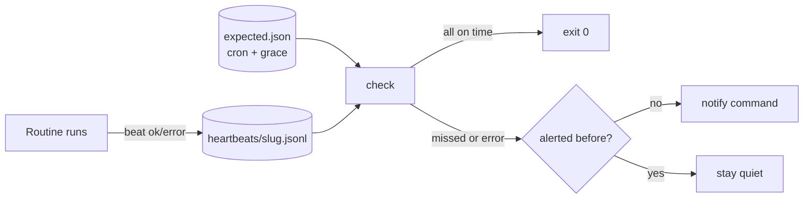

# routine-heartbeat

Know when a scheduled routine **didn't** run.

Most monitoring tells you when a job fails loudly. The harder case for AI agents
and cron jobs is the run that silently never happens: the scheduler skipped it,
the agent was paused, or the machine was asleep. routine-heartbeat keeps a small
**expected-fires registry** (cron schedule plus grace period per routine) and
compares it with the heartbeats each routine writes when it runs. Anything that
should have fired but didn't is reported as `STALE`, once per missed run.



## Features

- **Dead-man style.** Alerts on the absence of a heartbeat, not only on errors.
- **Cron schedules.** Standard 5-field cron (`*/15 7-21 * * *`, `30 8 * * 1-5`,
  `0 10 * * sat`), several expressions per routine, and an IANA time zone with
  correct DST handling.
- **Grace periods.** Each routine gets `grace_min` before a missed run counts.
- **One alert per missed run.** A de-dupe state file keys alerts by routine and
  expected fire time, so a stale routine alerts once and alerts again only when
  the next run is also missed.
- **Bootstrap-safe.** Routines added after `monitor_start` (or with their own
  `since`) report `unknown` instead of a false alarm.
- **Writer that never breaks the caller.** `beat` always exits 0, locks the file
  while appending, normalizes slugs (no path traversal) and creates files as
  owner-only (`0600`).
- **No dependencies.** Python 3.10+ standard library only.

## Quick start

```bash
git clone https://github.com/globe-teck/routine-heartbeat
cd routine-heartbeat
python3 -m routine_heartbeat check \
  --registry examples/expected.json --dir examples/heartbeats \
  --now 2026-03-05T10:20:00-05:00
```

```text
checked 2026-03-05T10:20:00-05:00
OK       inbox-watch                  expected=2026-03-05T10:00-05:00 last=2026-03-05T10:00:18-05:00
OK       morning-report               expected=2026-03-05T08:30-05:00 last=2026-03-05T08:31:02-05:00
STALE    nightly-backup               expected=2026-03-05T02:15-05:00 last=2026-03-04T02:16:10-05:00 missed, 485 min past expected fire
ERROR    weekly-review                expected=2026-02-28T10:00-05:00 last=2026-02-28T10:02:00-05:00 last run reported error
```

The example data is made up. Exit codes: `0` all on time, `2` at least one
`STALE` or `ERROR`, `1` the check itself failed (for example, a missing registry).

## 1. Describe what should run

`expected.json`:

```json
{
  "timezone": "America/New_York",
  "monitor_start": "2026-01-05T00:00:00-05:00",
  "routines": {
    "morning-report": {"cron": "30 8 * * 1-5", "grace_min": 20, "owner": "reports-agent"},
    "weekly-review":  {"cron": ["0 10 * * sat", "0 16 * * fri"], "grace_min": 60},
    "retired-sync":   {"cron": "0 * * * *", "active": false}
  }
}
```

| Field        | Meaning                                                          |
|--------------|------------------------------------------------------------------|
| `cron`       | One 5-field expression, or a list (the union of fires)           |
| `grace_min`  | Minutes after a scheduled fire before it counts as missed (default 15) |
| `active`     | `false` skips the routine (default `true`)                      |
| `owner`      | Optional; included in alerts                                     |
| `since`      | Optional; per-routine start time (overrides `monitor_start`)     |

## 2. Write a heartbeat from each routine

At the end of the routine (or in a `trap`):

```bash
python3 -m routine_heartbeat beat morning-report ok "12 items" --dir heartbeats --tz America/New_York
python3 -m routine_heartbeat beat nightly-backup error "upload failed" --dir heartbeats
```

Results: `ok`, `noop`, `skipped`, `error`, `started`. Each call appends one JSON
line to `heartbeats/<routine>.jsonl`:

```json
{"ts": "2026-03-05T08:31:02-05:00", "routine": "morning-report", "result": "ok", "note": "12 items"}
```

From Python, `routine_heartbeat.beat.record(dir, slug, result, note)` returns
`False` instead of raising.

## 3. Check on a schedule

```bash
*/10 * * * * cd /opt/routine-heartbeat && python3 -m routine_heartbeat check \
  --registry expected.json --dir heartbeats --state state/alerted.json \
  --notify-cmd "/opt/routine-heartbeat/examples/notify-stdout.sh"
```

`--notify-cmd` gets the text of new alerts on stdin (it runs without a shell).
Point it at your mail command, chat webhook script or push service.
`--format json` prints counts and per-routine statuses for dashboards.

Run the checker somewhere other than the thing it watches when you can, so a
dead machine can't hide its own missed runs.

## How a status is decided

For each active routine, with `F` = the latest scheduled fire at or before
`now - grace_min`:

| Status    | Rule                                                                  |
|-----------|-----------------------------------------------------------------------|
| `ok`      | newest heartbeat at or after `F - 2 min`                              |
| `error`   | on time, but the newest heartbeat has `result: error`                 |
| `unknown` | `F` is before `monitor_start`/`since` and no heartbeat exists yet     |
| `stale`   | anything else (no heartbeat, or the newest one is before `F`)         |
| `invalid` | the cron expression didn't parse (reported, never raised)             |

When both day-of-month and day-of-week are set, a day matches if either does,
as in classic cron. Wall-clock times that don't exist on a DST change day are
resolved by Python's `zoneinfo`.

## Tests

```bash
python3 -m pip install pytest
python3 -m pytest -v
```

47 offline tests cover the cron parser (ranges, steps, names, DST, unions), the
status rules, alert de-dupe, the never-raise writer (locking, permissions, slug
normalization) and the CLI. CI runs them on Ubuntu and macOS with Python 3.10
and 3.12, plus `shellcheck`.

## Authorship

Leigh Rodney, AI Researcher & Founder at Globe Teck (Python: basic). Built with
AI coding assistance. I defined the requirements, ran the tests, and reviewed
the changes.

## License

MIT. See [LICENSE](LICENSE).
